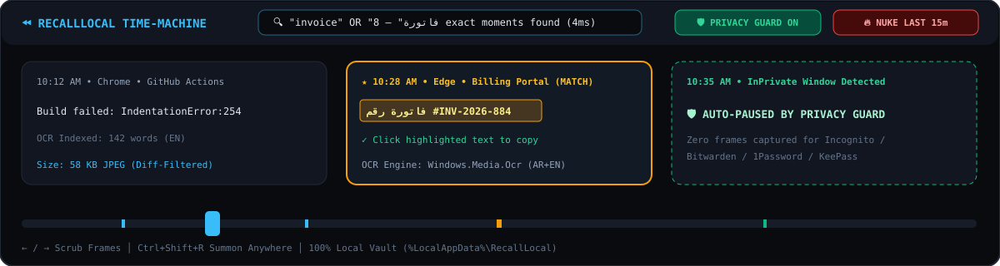
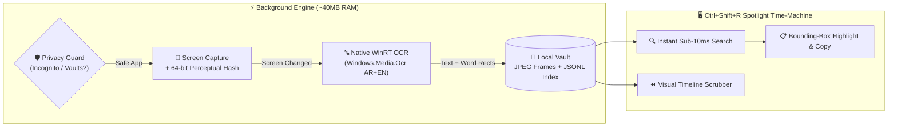

<a id="readme-top"></a>

<!-- CUSTOM 60FPS ANIMATED HERO BANNER -->
<div align="center">
  <a href="https://github.com/a1n2a3s6/recall-local/releases">
    
  </a>

  <br />
  <br />

  <!-- LIVE GITHUB STATS & DOWNLOAD BADGES -->
  <p>
    <a href="https://github.com/a1n2a3s6/recall-local/releases">
      
    </a>
    <a href="https://github.com/a1n2a3s6/recall-local/stargazers">
      
    </a>
    <a href="https://github.com/a1n2a3s6/recall-local/network/members">
      
    </a>
    
    
  </p>

  <!-- QUICK NAVIGATION -->
  <p>
    <a href="#-live-time-machine-preview"><strong>🎬 Time-Machine Preview</strong></a> &nbsp;│&nbsp;
    <a href="#-why-recalllocal"><strong>🎯 vs Windows Recall</strong></a> &nbsp;│&nbsp;
    <a href="#-bento-feature-suite"><strong>⚡ Features</strong></a> &nbsp;│&nbsp;
    <a href="#-architecture"><strong>🏗️ Architecture</strong></a> &nbsp;│&nbsp;
    <a href="#-download--install"><strong>📦 Download</strong></a>
  </p>
</div>

---

> [!IMPORTANT]
> **Windows Recall for ANY PC — open source, zero NPU required, and 100% under your control.**
> **RecallLocal** gives your Windows 10/11 PC a private photographic memory using Microsoft's built-in offline **WinRT OCR (`Windows.Media.Ocr`)** — no 4GB AI model downloads, no cloud servers, no telemetry. Press <kbd>Ctrl</kbd>+<kbd>Shift</kbd>+<kbd>R</kbd> anytime to scrub back through your day, search any **Arabic or English** word you saw hours ago, and click directly on past screenshots to copy text!

---

## 🎬 Live Time-Machine Preview

<div align="center">
  
</div>

---

## 🎯 Why RecallLocal?

| Capability | ⏪ RecallLocal (Open Source) | Microsoft Windows Recall |
| :--- | :---: | :---: |
| **Runs on ANY Windows 10 / 11 PC (No Copilot+ NPU)** | ✅ Works Everywhere | ❌ Locked to $1,500+ NPU PCs |
| **100% Open Source & Auditable Code (MIT)** | ✅ Full Source | ❌ Closed Proprietary |
| **Zero External AI Downloads (Native `Windows.Media.Ocr`)** | ✅ Built into Windows | ❌ Heavy local models |
| **Arabic + English Word-Box Highlight & Copy-From-Screen** | ✅ Instant Click-to-Copy | ⚠️ Limited |
| **Auto-Pause on Incognito / Password Managers + Nuke 15m** | ✅ Built-In Privacy Guard | ⚠️ Controversial defaults |
| **Smart Perceptual-Hash Diff (Skips Idle Screens)** | ✅ Saves 80%+ Disk | ❌ Heavy storage |

---

## ⚡ Bento Feature Suite

<table>
  <tr>
    <td width="33%" valign="top">
      <h3>🔍 Sub-10ms OCR Search</h3>
      <p>Indexes every <b>Arabic &amp; English</b> word on screen using native offline <code>Windows.Media.Ocr</code> along with exact word bounding boxes, App Name, and Window Title.</p>
    </td>
    <td width="33%" valign="top">
      <h3>⏪ Spotlight Time-Machine</h3>
      <p>Press <kbd>Ctrl</kbd>+<kbd>Shift</kbd>+<kbd>R</kbd> from any app to scrub smoothly back through your day, jump straight to search matches, and copy text directly off historical screenshots.</p>
    </td>
    <td width="33%" valign="top">
      <h3>🛡️ Automatic Privacy Guard</h3>
      <p>Instantly pauses capture whenever you open <b>Incognito / InPrivate</b> browsers, <b>Bitwarden</b>, <b>1Password</b>, <b>KeePass</b>, or any custom app in your blocklist.</p>
    </td>
  </tr>
  <tr>
    <td width="33%" valign="top">
      <h3>🧠 Smart Perceptual-Hash Diff</h3>
      <p>Computes a 64-bit grayscale hash before saving — if your screen hasn't changed, RecallLocal skips writing a duplicate frame, keeping storage ultra-light.</p>
    </td>
    <td width="33%" valign="top">
      <h3>🔥 1-Click Nuke Last 15m</h3>
      <p>Hit <b>Nuke Last 15 Minutes</b> from the System Tray or Spotlight bar to permanently erase recent frames and index entries in one click.</p>
    </td>
    <td width="33%" valign="top">
      <h3>♻️ Auto-Retention Quota</h3>
      <p>Automatically prunes snapshots older than your configured window (default <b>7 days</b>) so your local vault never bloats your SSD.</p>
    </td>
  </tr>
</table>

---

## 🏗️ Architecture



<details>
<summary><b>📂 Inspect Full C# .NET 8 Repository Tree</b></summary>

```text
recall-local/
├── .github/
│   └── workflows/
│       └── release.yml                 # Auto-builds standalone recall-local-windows-x64.exe
├── assets/
│   ├── hero.svg                        # Custom 60fps animated hero banner
│   └── timeline-demo.svg               # Live animated Time-Machine & Privacy Guard demo
├── src/
│   └── RecallLocal/
│       ├── RecallLocal.csproj          # net8.0-windows10.0.19041.0 (Zero NuGet deps)
│       ├── App.xaml / App.xaml.cs      # System Tray, Ctrl+Shift+R hotkey & Nuke menu
│       ├── Native/
│       │   └── Win32Interop.cs         # GetForegroundWindow, ProcessName & HotKeys
│       ├── Models/
│       │   ├── SnapshotRecord.cs       # Frame metadata + normalized OCR word bounding boxes
│       │   └── AppSettings.cs
│       ├── Engine/
│       │   ├── CaptureService.cs       # 64-bit perceptual hash diff + JPEG compressor
│       │   ├── OcrService.cs           # Native offline Windows.Media.Ocr (AR + EN)
│       │   ├── VaultStore.cs           # Fast local search index + auto-retention pruner
│       │   └── PrivacyGuard.cs         # Incognito & password manager auto-pause
│       └── Views/
│           ├── TimelineWindow.xaml(.cs)# Borderless Spotlight Scrubber & OCR Highlighter
│           └── SettingsWindow.xaml(.cs)# Privacy blocklist, retention & storage meter
└── README.md
```

</details>

---

## 📦 Download & Install

### Option 1: Standalone Windows `.EXE` (Zero Install)
Download **`recall-local-windows-x64.exe`** directly from **[GitHub Releases](https://github.com/a1n2a3s6/recall-local/releases)** and run!

### Option 2: Build From Source (.NET 8 SDK)
```powershell
git clone [https://github.com/a1n2a3s6/recall-local.git](https://github.com/a1n2a3s6/recall-local.git)
cd recall-local
dotnet run --project src/RecallLocal/RecallLocal.csproj
```

---

## ⌨️ Controls & Shortcuts

| Shortcut | Action |
| :---: | :--- |
| <kbd>Ctrl</kbd> + <kbd>Shift</kbd> + <kbd>R</kbd> | Summon / dismiss the **Time-Machine Spotlight** from any app |
| <kbd>←</kbd> / <kbd>→</kbd> | Scrub frame-by-frame backward or forward through time |
| **Click Highlighted Word** | Copy matched OCR text directly off a past screenshot |
| <kbd>Esc</kbd> | Close Time-Machine overlay instantly |

---

## 📄 License

Distributed under the **MIT License**. 100% local, zero telemetry, forever open source.

---

<div align="center">

<h3>👨‍💻 Engineered by Anas Alhelaly</h3>
<p><em>Day 15 (Week 3 Launch) of my <strong>365 Projects in 365 Days</strong> GitHub Challenge</em></p>

<p>
  <a href="https://anas-alhelaly.vercel.app/">
    
  </a>
  <a href="https://github.com/a1n2a3s6">
    
  </a>
  <a href="https://www.instagram.com/anas.alhelaly/">
    
  </a>
</p>

<p>⭐ <strong>If RecallLocal saved you from losing an important error, link, or note, drop a Star on the repo!</strong> ⭐</p>

<p><a href="#readme-top"><strong>⬆️ Back to Top</strong></a></p>

</div>
